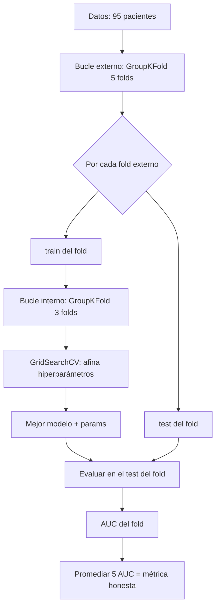

# Oncology Treatment Response — NeuroDx 🧠

Análisis estadístico y predictivo de la **respuesta al tratamiento** en pacientes
oncológicos con metástasis cerebrales tratadas con **radiocirugía estereotáctica
(SRS)**, evaluada con los **criterios RANO**.

> ⚠️ **Aviso:** este proyecto es un trabajo educativo y de investigación. **NO es
> un dispositivo médico** y no debe usarse para decisiones clínicas.

Este repositorio consolida y corrige el proyecto original del equipo
(`s20-10-data`, marca *Neuro-TX-Latam* / *NeuroDx*). Los errores corregidos y su
explicación están documentados en la **[guía de estudio](GUIA_DE_ESTUDIO.md)**.

---

## 🔒 Privacidad de los datos

El dataset original contenía el **número de historia clínica** (`EXPEDIENTE`),
un identificador directo que **no debe publicarse**.

En este repositorio los datos están **des-identificados**:

- `EXPEDIENTE` fue reemplazado por un `PACIENTE` pseudoanonimizado (hash SHA-256
  con *salt* privada, ver `src/data/deidentify.py`).
- `NOMBRE` e `ID_unico` fueron eliminados.
- El archivo crudo **NO se versiona** (va en `data/raw/`, ignorado por git).

**Nunca comitees el Excel/CSV crudo con `EXPEDIENTE`.** Para preparar datos
nuevos usá `scripts/deidentify.py`.

---

## Estructura del proyecto

```
oncology-treatment-response/
├── config.py                 # toda la configuración (columnas, modelo, rutas)
├── main.py                   # pipeline: limpiar + analizar + entrenar
├── app.py                    # app Streamlit de predicción
├── data/
│   └── dataset.csv           # dataset DES-IDENTIFICADO (466 registros)
├── src/
│   ├── data/
│   │   ├── loader.py         # carga CSV/Excel
│   │   ├── deidentify.py     # pseudoanonimización
│   │   └── cleaning.py       # normalización y limpieza
│   ├── analysis/
│   │   └── stats.py          # chi2, ANOVA, Fisher, test Z
│   ├── modeling/
│   │   └── train.py          # pipeline sklearn + SMOTE + evaluación
│   └── utils/
│       ├── logging.py
│       └── plotting.py
├── scripts/
│   ├── deidentify.py         # prepara un dataset crudo para publicar
│   └── check_data.py         # verifica que no haya PII
├── tests/
│   ├── test_deidentify.py
│   └── test_cleaning.py
└── requirements.txt
```

---

## Requisitos e instalación

```bash
python -m venv .venv
source .venv/bin/activate          # Linux/macOS
# .venv\Scripts\activate          # Windows

pip install -r requirements.txt
```

## Uso

### 1. Verificar los datos

```bash
python scripts/check_data.py
```

### 2. Entrenar el modelo

```bash
python main.py                     # Random Forest (default)
python main.py --model xgboost    # otro modelo
python main.py --stats            # incluye pruebas estadísticas
python main.py --help
```

Esto limpia los datos, entrena con el pipeline (imputación + one-hot + SMOTE +
modelo) y guarda en `results/`: métricas (`metrics.json`), reporte de
clasificación, matriz de confusión, curva ROC e importancia de features. El
pipeline completo queda en `models/`.

### 3. Ejecutar la app

```bash
streamlit run app.py
```

---

## Modelos disponibles

| Nombre | Descripción |
|--------|-------------|
| `random_forest` | Bosque aleatorio (default) |
| `gradient_boosting` | Gradient Boosting |
| `logistic` | Regresión logística |
| `decision_tree` | Árbol de decisión |
| `xgboost` | XGBoost |

**Métrica principal: AUC-ROC.** La clase minoritaria (progresión) representa
~3% de los datos (16 de 466), por lo que la exactitud es engañosa: un modelo
que siempre predice "éxito" tendría ~96% de exactitud. Por eso se usa SMOTE y
se evalúa con AUC-ROC y las métricas de la clase minoritaria.

---

## Sobre los datos

- **Fuente:** datos clínicos del proyecto No-Country `s20-10-data`, aportados
  por una médica (metástasis cerebrales tratadas con SRS).
- **Registros:** 466 tumores de 97 pacientes (varios tumores por paciente).
- **Variables:** edad, sexo, tumor primario, subtipo histológico, perfil
  molecular, localización, tamaño, dosis, técnica, tratamiento sistémico,
  cirugía previa, SRS y respuesta (RANO → binaria).
- **Clases:** éxito (control de enfermedad) = 450 · fracaso (progresión) = 16.

> **Limitación importante:** el desbalance extremo y el tamaño pequeño de la
> clase minoritaria hacen que los resultados sean ruidosos. Es un proyecto de
> aprendizaje, no un modelo con validez clínica.

---

## Resultados y limitaciones

Estos resultados se obtuvieron ejecutando el pipeline sobre el dataset
des-identificado (`data/dataset.csv`, 464 registros tras limpieza). Podés
reproducirlos con `python main.py --stats` y `python scripts/compare_models.py`.

### Hallazgos estadísticos

Variables con asociación estadísticamente significativa con la respuesta
(p < 0.05):

| Variable | Prueba | p-valor | Interpretación |
|----------|--------|---------|----------------|
| TUMOR PRIMARIO | chi² | 0.0001 | asociación significativa |
| TECNICA | chi² | 0.0025 | asociación significativa |
| SRS | chi² | 0.0484 | asociación significativa |
| DOSIS (Gy) | ANOVA | 0.0000 | dosis media distinta según respuesta |

No resultaron significativas: `SEXO` (p=0.27) y `CIRUGIA PREVIA` (p=0.10).

### Metodología de validación (por qué importa)

Para no autoengañarnos, comparamos **dos unidades de análisis** con **tres
formas de validar**:

**Dos unidades de análisis**

- **Nivel tumor** (466 filas): cada fila es un tumor. Pregunta: *"¿este tumor
  progresa?"* → 16 progresiones de 448 (3.4%).
- **Nivel paciente** (95 filas): cada fila es un paciente, con sus tumores
  agregados. Pregunta: *"¿este paciente progresa?"* (fracasa si **cualquier**
  tumor progresa) → 12 de 83 (12.6%).

**Tres formas de validar**

1. **Split aleatorio (por fila)** ⚠️ — ignora que los tumores de un mismo
   paciente están correlacionados. Produce fuga de datos.
2. **GroupKFold (por paciente)** — un paciente queda en train *o* test, nunca
   en ambos. Es la forma correcta para datos con múltiples registros por sujeto.
3. **Validación anidada** — además, afina los hiperparámetros dentro de cada
   fold (bucle interno), de modo que el ajuste no "gaste" los datos de
   evaluación.

**El diagrama de la validación anidada (dos bucles):**

```
VALIDACIÓN ANIDADA (dos bucles) — datos: 95 pacientes

┌───────────────── BUCLE EXTERNO: GroupKFold (5 folds) ─────────────────┐
│  Cada paciente queda en test UNA sola vez (nunca en train + test).    │
│                                                                       │
│   fold 1:  [ train  train  train  train  TEST ]                       │
│   fold 2:  [ train  train  train  TEST  train ]                       │
│   ...      (5 combinaciones, una por fold)                            │
└───────────────────────────────┬───────────────────────────────────────┘
                                │  por cada fold, su "train" entra a...
                                ▼
┌───────────────── BUCLE INTERNO: GroupKFold (3 folds) ─────────────────┐
│  Dentro del train se AFINAN los hiperparámetros:                      │
│   GridSearchCV prueba (n_estimators, max_depth, ...)                  │
│   y elige la combinación con mejor AUC.                               │
│                                                                       │
│   ⚠ Los datos del TEST externo NO participan en esta elección.        │
└───────────────────────────────┬───────────────────────────────────────┘
                                │
                                ▼
   El mejor modelo se evalúa en el TEST externo (datos nunca vistos)
   → AUC del fold. Se promedian los 5 AUC → métrica honesta.
```



### Comparación de modelos (split aleatorio ⚠️)

> **Advertencia:** esta tabla usa un split aleatorio por FILA, que **no respeta
> el agrupamiento por paciente** (466 tumores de 97 pacientes). Como un mismo
> paciente puede quedar con tumores en train *y* test, el AUC está **inflado por
> fuga de datos**. Ver la evaluación correcta más abajo.

| Modelo | AUC-ROC | Accuracy | Recall progresión (umbral 0.5) | Precision progresión |
|--------|---------|----------|-------------------------------|----------------------|
| XGBoost | 0.839 | 0.957 | 0.00 | 0.00 |
| Random Forest | 0.829 | 0.943 | 0.00 | 0.00 |
| Gradient Boosting | 0.801 | 0.943 | 0.00 | 0.00 |
| Logistic Regression | 0.759 | 0.914 | 0.20 | 0.11 |
| Decision Tree | 0.567 | 0.907 | 0.20 | 0.10 |

### Evaluación honesta (GroupKFold por paciente)

Al separar por **PACIENTE** (`GroupKFold`, 5 folds) — de modo que un paciente no
aparezca a la vez en train y test — el rendimiento **colapsa a nivel azar**:

| Modelo | AUC medio (GroupKFold) | Recall progresión |
|--------|------------------------|-------------------|
| Random Forest | **0.48** | 0.00 |
| XGBoost | 0.60 | 0.00 |

El AUC de 0.83 del split aleatorio era **fuga de datos**, no capacidad real del
modelo. Esto se reproduce con `python scripts/evaluate_grouped.py`.

### Agregación por paciente (la unidad correcta)

Si en lugar de 466 tumores usamos **una fila por paciente** (95 pacientes), con la
respuesta definida como *"el paciente progresa si CUALQUIER tumor progresa"*, el
resultado cambia:

| Método | AUC medio | Recall progresión |
|--------|-----------|-------------------|
| GroupKFold por paciente | 0.72 | 0.34 |
| Validación anidada (con tuning) | 0.76 | — |

Agregar por paciente (a) reduce el desbalance (12/95 = 12.6% vs 16/448 = 3.4%) y
(b) define un endpoint clínicamente más sensato. Aparece una **señal débil pero
real** (AUC ~0.72–0.76) que a nivel tumor estaba totalmente oculta.

### Resumen de todos los resultados

| Validación | Unidad de análisis | AUC | Conclusión |
|------------|--------------------|-----|------------|
| Split aleatorio (⚠️ fuga) | tumor | 0.83 | falso optimismo |
| GroupKFold | tumor | 0.48 | nivel azar |
| GroupKFold | paciente | 0.72 | señal débil |
| Anidada (con tuning) | paciente | 0.76 | señal débil (honesta) |

### Hallazgos clave

1. **La validación por fila fabricaba un AUC falso de 0.83** (fuga por paciente).
2. **A nivel tumor el modelo es azar** (AUC 0.48): "¿este tumor progresa?" no se
   puede responder con estas variables.
3. **Agregando por paciente emerge una señal** (AUC 0.72–0.76): "¿este paciente
   progresa?" sí tiene algo de señal. Cambiar la unidad de análisis cambió el
   resultado de azar a informativo.
4. **La validación anidada confirma la señal sin inflarla** (0.76 ≈ 0.72), es
   decir, el tuning de hiperparámetros no estaba sobreajustando.
5. **Todo sigue siendo ruidoso**: con 12 casos de progresión, la varianza entre
   folds es enorme (std ~0.15). Hace falta más data para confirmar.

### Conclusión honesta

- A nivel **tumor**, el modelo es **azar** (AUC ~0.5) una vez corregida la fuga.
- A nivel **paciente** (agregando), hay una **señal débil** (AUC ~0.72–0.76,
  recall de progresión ~0.34), pero con **12 casos de progresión** sigue siendo
  muy ruidosa (std ~0.15) y sin validez clínica.
- La exactitud (~95%) es engañosa por el **desbalance** y la **fuga por paciente**.
- Para un predictor clínicamente útil haría falta recopilar **muchos más casos de
  progresión** (idealmente cientos) y validar con cohortes separadas.

> **Lección clave:** en datos clínicos con múltiples registros por paciente,
> SIEMPRE validar con `GroupKFold` por paciente. Ignorarlo produce resultados
> falsamente optimistas.

---

## Guía de estudio

Los errores del proyecto original y cómo se corrigieron están explicados en
**[GUIA_DE_ESTUDIO.md](GUIA_DE_ESTUDIO.md)**.

## Próximos pasos: nueva investigación

Este proyecto dejó claro que con los datos actuales (12–16 casos de progresión)
no se puede construir un modelo clínicamente válido. Para una investigación
formal y útil, elaboramos dos documentos:

- **[PROTOCOLO.md](PROTOCOLO.md)** — protocolo técnico de recolección: PICO,
  endpoints, cálculo de muestra (EPV), diccionario de datos y metodología de
  validación.
- **[PROPUESTA_INVESTIGACION.md](PROPUESTA_INVESTIGACION.md)** — propuesta formal
  para presentar al equipo médico y convencerlos de colaborar en la recolección.
